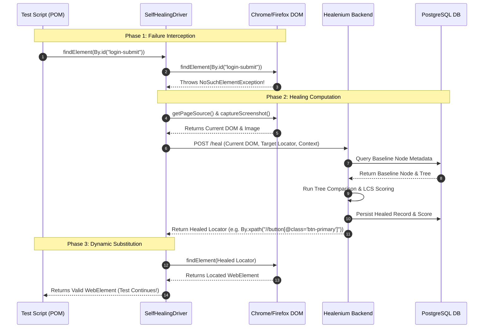

# Healenium: The Comprehensive SDET Master Guide & Technical Study Material
> **Target Audience:** SDETs, QA Automation Architects, Senior Engineers, and Test Leads  
> **Topic:** AI-Driven Self-Healing Test Automation for Web with Healenium & Selenium  
> **Reference Documentation:** [Healenium Official Documentation](https://healenium.io) | [Healenium GitHub Organization](https://github.com/healenium)

---

## Table of Contents
1. [Chapter 1: Introduction to Healenium & Self-Healing Locators](#chapter-1-introduction-to-healenium--self-healing-locators)
2. [Chapter 2: Architecture & Workflow Deep Dive](#chapter-2-architecture--workflow-deep-dive)
3. [Chapter 3: Core Technical Concepts & Locator Healing Engine](#chapter-3-core-technical-concepts--locator-healing-engine)
4. [Chapter 4: Components, Ecosystem & Technologies](#chapter-4-components-ecosystem--technologies)
5. [Chapter 5: Conceptual Scenarios & Educational Code Snippets](#chapter-5-conceptual-scenarios--educational-code-snippets)
6. [Chapter 6: Configuration, Setup & Framework Integration](#chapter-6-configuration-setup--framework-integration)
7. [Chapter 7: Enterprise Troubleshooting & Debugging Matrix](#chapter-7-enterprise-troubleshooting--debugging-matrix)
8. [Chapter 8: Best Practices, Risks, Pitfalls & Governance](#chapter-8-best-practices-risks-pitfalls--governance)
9. [Chapter 9: Real-World SDET Case Studies](#chapter-9-real-world-sdet-case-studies)
10. [Chapter 10: Comprehensive Interview Preparation (40+ Questions & Answers)](#chapter-10-comprehensive-interview-preparation-40-questions--answers)
11. [Chapter 11: Quick Revision Notes, Component Comparison & Glossary](#chapter-11-quick-revision-notes-component-comparison--glossary)
12. [Chapter 12: 14-Day Structured SDET Study & Mastery Roadmap](#chapter-12-14-day-structured-sdet-study--mastery-roadmap)

---

# Chapter 1: Introduction to Healenium & Self-Healing Locators

## 1.1 What is Healenium?
**Healenium** is an open-source, AI-powered testing framework designed by EPAM Systems to overcome one of test automation's most persistent bottlenecks: **test flakiness caused by brittle UI locators**. 

Healenium operates as an intelligent mediator between Selenium WebDriver and the browser DOM. When an application under test (AUT) undergoes UI or structural changes that break conventional Selenium element lookups (`NoSuchElementException`), Healenium intercepts the failure, compares the current DOM structure against a historical baseline stored in a backend database, computes similarity scores across candidate nodes using element-matching algorithms, substitutes the broken selector with the best-matching candidate at runtime, and persists the healed locator for reporting and triage.

```
+-----------------------------------------------------------------------------------+
|                            The Core Value Proposition                             |
|  Traditional Automation: Minor UI Change  --> NoSuchElementException --> Run Fails|
|  Healenium Automation:   Minor UI Change  --> Intercepted --> Node Scored         |
|                          --> Substitute Candidate --> Run Passes --> Report Logged|
+-----------------------------------------------------------------------------------+
```

---

## 1.2 The Problem of Brittle Locators in Enterprise Test Automation
In modern Agile and CI/CD development pipelines, front-end code bases undergo continuous churn:
1. **Dynamic IDs & Framework Attributes:** Modern JavaScript frameworks (React, Angular, Vue, Blazor) generate dynamic identifiers (e.g., `id="btn_j83kx_login"`, `data-v-4a92c3`), rendering standard attribute-based locators obsolete upon rebuild.
2. **Design System & Component Library Refactoring:** Updating UI libraries (such as moving from Bootstrap to Material-UI, Tailwind, or internal design systems) shifts parent hierarchy, class names, wrapper `<div>` nodes, and tag structures.
3. **A/B Testing and Responsive Layout Swaps:** Elements may shift position or gain wrapper containers without changing functional business intent.
4. **Maintenance Overhead (The "Automation Tax"):** Studies across enterprise automation suites reveal that automation engineers spend **30% to 50% of their maintenance time** triaging false failures caused by harmless markup shifts rather than real software bugs.

---

## 1.3 What "Self-Healing" Really Means
Self-healing in UI test automation does **not** rewrite application source code or magically repair broken user journeys. Instead, it refers to **runtime dynamic locator recovery**:
* **Runtime Recovery:** Preventing unnecessary suite crashes during execution by finding the target element despite syntactic changes in its selector.
* **Telemetry & Baselines:** Recording complete DOM trees and contextual metadata (attributes, ancestor/descendant relationships, text values, layout coordinates) when a test passes.
* **Discrepancy Resolution:** Using machine-learning-inspired distance metrics and tree-matching algorithms to identify which node in the new DOM corresponds to the recorded baseline element.
* **Auditability & Reporting:** Providing the QA engineer with a visual diff (screenshot before and after, similarity score, suggested selector) so humans retain final approval over selector updates.

---

## 1.4 Advantages, Disadvantages, and Limitations

### Key Advantages
* **Drastic Reduction in Flaky CI Pipeline Failures:** Nightly regression runs complete without aborting halfway through critical paths due to minor CSS or DOM wrapper alterations.
* **Reduced Automation Maintenance Debt:** Engineers spend less time updating `By.xpath` or `By.cssSelector` strings and more time writing high-value test scenarios.
* **Detailed Audit Trails & Dashboards:** Generates visual reports highlighting the exact element healed, the historical baseline, and the similarity percentage.
* **IDE Integration:** Through tools like the Healenium IntelliJ IDEA plugin, developers and SDETs can accept healed locators directly into their Page Object source files with a single click.
* **Flexible Integration Models:** Can be integrated as a Java client wrapper (`healenium-web`) or as an out-of-process protocol proxy (`healenium-proxy`) for polyglot frameworks (Python, C#, JavaScript/TypeScript, Ruby).

### Disadvantages and Trade-offs
* **Execution Overhead (Latency):** When an element breaks, the healing engine performs DOM captures, HTTP requests to the backend service, tree-traversal matching, and screenshot generation. A healed lookup takes roughly 300ms–2000ms longer than a direct native lookup.
* **Infrastructure Complexity:** Requires deploying and maintaining supporting microservices: a Spring Boot backend (`healenium-backend`) and a relational datastore (`PostgreSQL`), typically via Docker containers.
* **Risk of False Positives:** In scenarios where multiple sibling elements share similar properties (e.g., rows in a table, repeated card components, identical icon buttons), Healenium might match the wrong element, causing tests to pass while interacting with incorrect data.
* **False Sense of Security:** If teams rely solely on self-healing without reviewing the dashboard, test suites can diverge from application reality, masking underlying UI defects or unexpected design regressions.

### Inherent Limitations
* **Cannot Fix Functional Application Defects:** If an element is missing because of an unhandled backend error, an unrendered component, or an authentication failure, Healenium cannot and should not heal it.
* **Complex Canvas / Shadow DOM / iFrames:** Standard tree comparison algorithms can struggle with closed Shadow DOM roots, nested multi-origin iFrames, or HTML5 canvas-rendered components.
* **Radical Business Flow Restructuring:** If a checkout flow changes from a 3-step modal to an accordion layout with entirely distinct controls, selector matching scores fall below acceptable thresholds, resulting in expected healing failures.

---

## 1.5 Traditional Selenium vs. Healenium: Head-to-Head Comparison

| Attribute | Standard Selenium WebDriver | Healenium-Enhanced Automation |
| :--- | :--- | :--- |
| **Driver Type** | Native `RemoteWebDriver`, `ChromeDriver`, etc. | Wrapped `SelfHealingDriver` (or routed via `Healenium-Proxy`) |
| **Behavior on Selector Mismatch** | Throws `NoSuchElementException` immediately | Intercepts exception; queries backend; attempts DOM healing |
| **Element Baseline Storage** | None; stateless execution | PostgreSQL datastore holding DOM trees, paths, and attributes |
| **Tolerance to DOM Refactoring** | 0% (any selector break halts the test step) | High (heals based on configurable similarity score, e.g., 0.6) |
| **CI/CD Reliability** | Vulnerable to minor frontend CSS/ID churn | Resilient; tests continue while logging healing events |
| **Infrastructure Footprint** | None (just the browser driver / Grid) | Requires Dockerized Backend and PostgreSQL services |
| **Failure Triaging Time** | High; manual inspection of logs and screenshots | Low; dedicated Healenium Web Dashboard with before/after diffs |
| **Language Support** | Universal (Java, Python, C#, JS, Ruby, Go) | Client library: Java (Native); Proxy: Language-agnostic |

---

# Chapter 2: Architecture & Workflow Deep Dive

## 2.1 Architectural Components Overview
The Healenium ecosystem comprises four main logical components:

```
+--------------------------------------------------------------------------------------+
|                                 HEALENIUM ARCHITECTURE                               |
|                                                                                      |
|   +-----------------------+              +---------------------------------------+   |
|   |   Automation Suite    |              |       Docker / Host Environment       |   |
|   |  (Java / TestNG /     |              |                                       |   |
|   |   Page Object Model)  |              |   +-------------------------------+   |   |
|   +-----------+-----------+              |   |     Healenium Backend         |   |   |
|               |                          |   |        (Port 7883)            |   |   |
|        [healenium-web]                   |   |  - Similarity Engine          |   |   |
|        (SelfHealingDriver)               |   |  - REST APIs                  |   |   |
|               |                          |   |  - Web Reporting Dashboard    |   |   |
|               |  1. Find Element         |   +---------------+---------------+   |   |
|               +------------------------->|                   |                   |   |   |
|               |                          |                   | SQL Queries       |   |   |
|               |  2. If Broken:           |                   v                   |   |   |
|               |     POST /heal/elements  |   +---------------+---------------+   |   |
|               +------------------------->|   |     PostgreSQL DB             |   |   |
|               |                          |   |        (Port 5432)            |   |   |
|               |  3. Return Candidate     |   |  - Baseline Trees             |   |   |
|               |<-------------------------+   |  - Selector History           |   |   |
|               |                          |   |  - Healing Results            |   |   |
|               v                          |   +-------------------------------+   |   |
|   +-----------+-----------+              +---------------------------------------+   |
|   |    Target Browser     |                                                          |   |
|   |  (Chrome/Edge/Firefox)|                                                          |   |
|   +-----------------------+                                                          |   |
+--------------------------------------------------------------------------------------+
```

### 1. Healenium Web (`healenium-web`)
* **Role:** A Java client library that acts as a wrapper around Selenium's native `WebDriver`.
* **Mechanism:** Implements a proxy or decorator pattern around `WebDriver` and `WebElement`. When `driver.findElement(By)` is invoked, it delegates first to the standard Selenium driver. If successful, it captures element context (DOM tree, node attributes, position) and asynchronously transmits it to the backend to update the baseline. If `NoSuchElementException` is encountered, it triggers the recovery routine.

### 2. Healenium Proxy (`healenium-proxy`)
* **Role:** A language-agnostic, middleware proxy server sitting between client test code and Selenium Grid / WebDriver.
* **Mechanism:** Conforms to the W3C WebDriver Specification. It intercepts standard HTTP wire commands (e.g., `POST /session/{id}/element`). If the browser node returns an error status code (Element Not Found), the proxy captures the page source directly from the browser session, calls the Healenium Backend for matching, and rewrites the command using the healed locator before returning the result to the test runner. This enables Python, C#, Robot Framework, and JavaScript suites to use Healenium without rewriting their codebase into Java.

### 3. Healenium Backend (`healenium-backend`)
* **Role:** The analytical brain of the ecosystem, packaged as a Spring Boot microservice.
* **Responsibilities:**
  * Computes similarity scores between historical baseline elements and candidate nodes in the current DOM.
  * Manages the lifecycle of selectors, healing sessions, and test execution metadata.
  * Hosts the embedded **Healenium Web Reporting Dashboard** (accessible via browser at `http://localhost:7883/healenium/report/`).
  * Exposes RESTful endpoints (e.g., `/healenium/selector`, `/healenium/elements`) consumed by client drivers or proxy layers.

### 4. PostgreSQL Database
* **Role:** Relational persistence engine.
* **Schema Content:**
  * `selector`: Stores original locator strings, locator types (`xpath`, `id`, `css`), command keys, and unique hashes.
  * `meta`: Stores contextual metadata including page URL, test class name, method name, and browser parameters.
  * `healing`: Stores healing events, historical baseline DOM trees, screenshot hashes, calculated similarity scores, healed selector values, and manual validation statuses (accepted/rejected/pending).

---

## 2.2 Step-by-Step Locator Healing Workflow

### Stage 1: The Baseline Capture (Passing Test Execution)
1. The test triggers `driver.findElement(By.id("login-submit"))`.
2. Selenium searches the browser DOM and successfully finds the element.
3. The Healenium client/proxy intercepts the successful response.
4. It extracts node metadata: HTML tag name, all attributes (`id`, `class`, `name`, `type`, custom attributes), text content, parent/child hierarchy, and surrounding DOM subtree.
5. This metadata is sent to `Healenium-Backend` and recorded in PostgreSQL as the **Baseline State** for `By.id("login-submit")`.
6. Control returns to the test script with zero disruption.

### Stage 2: The Failure Detection (DOM Has Changed)
1. A new build modifies the button markup: `<button id="login-submit">` becomes `<button id="btn-auth-submit" class="btn-primary">`.
2. The test triggers `driver.findElement(By.id("login-submit"))`.
3. The underlying Selenium WebDriver queries the DOM, fails to match `login-submit`, and raises a `NoSuchElementException`.
4. Traditional Selenium would abort execution immediately. Healenium catches this exception in its wrapper layer.

### Stage 3: The Healing Computation
1. Healenium captures the current, full page DOM tree and current viewport screenshot from the active browser session.
2. It constructs an HTTP request to `Healenium-Backend` containing:
   * Original locator identifier and type.
   * Current page DOM structure.
   * Current execution context (test method, class).
3. The backend retrieves the historical baseline DOM node and its contextual signature from PostgreSQL.
4. The algorithm traverses the current DOM, filtering candidate nodes with matching or compatible tag structures.
5. For each candidate node, it computes a multi-factor similarity score (weighing tag, path, attributes, text, and relative positioning).
6. Candidates exceeding the configured score threshold (e.g., `score-cap=0.6`) are sorted by similarity. The candidate with the highest score is chosen.

### Stage 4: Runtime Substitution & Reporting
1. The backend constructs a new, valid locator path (such as an optimized XPath or CSS selector) pointing precisely to the selected candidate.
2. The backend sends the healed selector and candidate details back to the client wrapper or proxy.
3. The client driver executes `findElement` using the healed locator. The target element is located and returned as a standard `WebElement`.
4. A healing event record is created in PostgreSQL with:
   * Original locator vs. Healed locator.
   * Matching similarity percentage.
   * Visual screenshots (highlighting the baseline vs. the healed element).
5. The test execution continues uninterrupted, executing clicks, typing, or assertions.



---

## 2.3 Integration Approaches: Healenium-Web vs. Healenium-Proxy

Understanding when to choose `healenium-web` versus `healenium-proxy` is a vital SDET architectural decision:

```
Approach A: Native Client Library (Healenium-Web)
[Java Test Suite] ---> [SelfHealingDriver Decorator] ---> [Selenium WebDriver] ---> [Browser]
                                |
                                +-------------------------> [Healenium Backend] ---> [Postgres]

Approach B: Network Proxy (Healenium-Proxy)
[Any Suite: Python/C#/JS] ---> [Healenium Proxy Server] ---> [Selenium Grid/Browser]
                                      |
                                      +--------------------> [Healenium Backend] ---> [Postgres]
```

### Detailed Structural Comparison:

| Decision Factor | Healenium-Web (Client Approach) | Healenium-Proxy (Proxy Approach) |
| :--- | :--- | :--- |
| **Language Dependency** | Strictly **Java** (JDK 8/11/17+) | **Language-Agnostic** (Python, C#, JS/TS, Ruby, Go) |
| **Code Modification** | Minor: Wrap driver with `SelfHealingDriver.create(delegate)` | Zero client code changes: Point RemoteWebDriver URL to proxy |
| **Transport Overhead** | Minimal: Direct method calls; HTTP only during healing | Moderate: Every WebDriver command passes through the proxy network hop |
| **Ideal Use Case** | Pure Java/TestNG/JUnit enterprise frameworks | Multi-language orgs, Selenium Grid, or Dockerized Selenoid setups |
| **Setup Complexity** | Include Maven/Gradle dependency + `healenium.properties` | Deploy additional Docker container for `healenium-proxy` |

---

# Chapter 3: Core Technical Concepts & Locator Healing Engine

## 3.1 Locators and Selector Strategies
In standard web automation, locators are query expressions instructing the browser engine how to identify DOM nodes:
* Direct attributes: `By.id("username")`, `By.name("email")`
* Stylistic classes: `By.className("form-input")`
* Link heuristics: `By.linkText("Sign Out")`
* Hierarchical queries: `By.xpath("//div[@class='auth']//input[@type='text']")`
* CSS expressions: `By.cssSelector("form.auth-form > input[type='text']")`

When front-end teams modify class names, wrap inputs in layout containers, or swap static IDs for framework-generated tokens, hardcoded selectors fail.

---

## 3.2 The DOM Tree Representation
The Document Object Model (DOM) is a hierarchical tree composed of nodes. Each node possesses:
* **Tag name** (`DIV`, `BUTTON`, `INPUT`)
* **Attribute map** (`id`, `class`, `placeholder`, `aria-label`, `style`)
* **Text contents** (inner text, whitespace trimmed text)
* **Topological coordinates** (depth in tree, sibling index, parent tag, child count)
* **Rendered layout metrics** (height, width, screen coordinates)

Healenium converts the DOM into an internal tree data structure. When an element is first located, its path from the root `<html>` tag down to the target leaf, along with its full attribute state, is persisted.

---

## 3.3 The Healing Algorithm & Similarity Scoring
Healenium calculates node similarity using a combination of **Tree Comparison**, **Longest Common Subsequence (LCS)**, and **Weighted Feature Matching**:

```
Total Similarity Score S = w1*S_tag + w2*S_id + w3*S_class + w4*S_text + w5*S_path + w6*S_attr
Where:
- w1..w6: Predefined weight coefficients representing attribute importance
- S_xxx:  Individual similarity metric between baseline and candidate (0.0 to 1.0)
```

1. **Tag Match ($S_{tag}$):** Evaluates if the candidate shares the same tag. If the baseline is `<button>` and the candidate is `<div>`, the score drops significantly unless specific styling/role equivalents apply.
2. **Path Distance & Tree Hierarchy ($S_{path}$):** Computes tree-edit distance or LCS between the ancestor path strings of the baseline and candidate nodes.
3. **Class & Attribute Overlap ($S_{class}, S_{attr}$):** Evaluates Jaccard similarity across class tokens (e.g., `["btn", "btn-primary", "large"]` vs `["btn", "btn-primary", "extra-large"]`).
4. **Text Content Similarity ($S_{text}$):** Uses string distance algorithms (such as Levenshtein or Cosine distance) on inner text values.
5. **Score Cap Threshold:** Healenium defines a cutoff threshold (default: `0.6` or 60%). Candidates scoring below this threshold are discarded.

---

## 3.4 Healing Outcomes: Success, Failure, and False Positives

```
                                  [Element Not Found]
                                           |
                                  Traverse Candidate Nodes
                                           |
                         +-----------------+-----------------+
                         |                                   |
              Max Score >= score-cap              Max Score < score-cap
                         |                                   |
                Select Candidate                     [Healing Failure]
                         |                         NoSuchElementException
             +-----------+-----------+                     Thrown
             |                       |
      Matches Real Target    Wrong Element Picked
             |                       |
      [Healing Success]       [False Positive]
     Test Continues Validly   Wrong Node Clicked!
```

### 1. Healing Success (True Positive)
The candidate chosen is indeed the element intended by the test engineer. The test performs its action, assertions execute, and the overall test verdict remains accurate.

### 2. Healing Failure (True Negative)
No candidate in the current DOM achieves a similarity score equal to or higher than `score-cap` (e.g., the element was completely removed from the page). Healenium respects this, rethrows `NoSuchElementException`, and alerts the engineer that the component is missing.

### 3. False-Positive Healing (The SDET's Primary Hazard)
The engine finds an element that achieves a score $\ge 0.6$, but it is **not** the intended element. For instance, in a table with ten identical "Delete" buttons in different rows, Healenium might heal a broken locator for Row 1 by binding to the "Delete" button in Row 2. The test clicks the wrong button, passing the step but corrupting application state.

---

## 3.5 Recovering an Element vs. Validating Application Behavior
A vital distinction for any Senior SDET:
* **Element Recovery** is purely syntactic. It asks: *"Can we find a DOM node that looks structurally similar to the one we used previously?"*
* **Behavioral Validation** is semantic. It asks: *"Is the application delivering the correct business outcome?"*

> **Crucial Rule:** Self-healing recovers *locators*, not *requirements*. If a developer changes a "Submit" button to a "Cancel" button in the same form container, Healenium might recover the button (high structural similarity), click it, and cause the form to clear instead of submit. **Hard assertions on page state, URLs, database records, and success banners must always validate behavior.**

---

# Chapter 4: Healenium Components and Technologies

To deploy and maintain Healenium in an enterprise environment, an SDET must understand its underlying technology stack.

```
+----------------------------------------------------------------------------------+
|                            HEALENIUM TECHNOLOGY STACK                            |
|                                                                                  |
|   +-----------------------+   +-----------------------+   +------------------+   |
|   |   Java / Test Engine  |   |   Healenium Backend   |   |    Datastore     |   |
|   |  - JDK 8, 11, 17+     |   |  - Spring Boot        |   |  - PostgreSQL    |   |
|   |  - Selenium 3.x / 4.x |   |  - RESTful APIs       |   |  - Port 5432     |   |
|   |  - TestNG / JUnit     |   |  - Tree Compare Engine|   |  - Schemas:      |   |
|   |  - Maven / Gradle     |   |  - Port 7883          |   |    selectors,    |   |
|   +-----------------------+   +-----------------------+   |    healing_log   |   |
|                                                           +------------------+   |
|   +-----------------------+   +-----------------------+                          |
|   |   Containerization    |   |     Client Proxy      |                          |
|   |  - Docker Compose     |   |  - Healenium-Proxy    |                          |
|   |  - Docker Engine      |   |  - Netty / Reverse    |                          |
|   |  - Microservice mesh  |   |    HTTP Proxy         |                          |
|   +-----------------------+   +-----------------------+                          |
+----------------------------------------------------------------------------------+
```

## 4.1 Component Breakdown

### 1. Selenium WebDriver
* **Role:** The standard browser automation API.
* **Relationship:** Healenium does not replace Selenium; it wraps Selenium's `WebDriver` interface (`ChromeDriver`, `FirefoxDriver`, `RemoteWebDriver`).

### 2. Java & Build Tools (Maven / Gradle)
* **Role:** Primary development ecosystem for `healenium-web`.
* **Relationship:** Brought in via standard dependency coordinates (`com.epam.healenium:healenium-web`). Dependencies include ByteBuddy or reflection utilities used to intercept driver invocations.

### 3. Docker & Docker Compose
* **Role:** Orchestrates the runtime environment for the backend and database.
* **Relationship:** Provides a reproducible, zero-configuration setup for local and CI/CD environments. A single `docker-compose.yaml` file launches both `healenium-backend` and `postgres-db`.

### 4. PostgreSQL
* **Role:** The persistence layer.
* **Relationship:** Houses historical selector baselines, DOM snapshots, and healing telemetry. Ensures that locator baselines persist across different test runs and CI/CD pipelines.

### 5. Healenium Backend (Spring Boot)
* **Role:** Computes similarity metrics and serves the HTML reporting dashboard.
* **Relationship:** Exposes ports (typically `7883`) to accept DOM snapshots from running tests, run tree-diff algorithms, and serve the visual review dashboard.

---

# Chapter 5: Conceptual Scenarios & Educational Code Snippets

The following conceptual snippets illustrate the internal mechanics of Healenium.

---

## Scenario 5.1: The Baseline State (Passing Lookup)

### Initial Application HTML
```html
<!-- Production UI: Sprint 1 -->
<div class="header-auth-panel">
    <button id="btn-login-submit" class="ui-btn primary-action" type="submit">
        Log In
    </button>
</div>
```

### Automation Test Code (Page Object)
```java
// Standard locator written by automation engineer
private By loginButton = By.id("btn-login-submit");

public void clickLogin() {
    // Wrapped SelfHealingDriver executes this call
    driver.findElement(loginButton).click();
}
```

### What Happens Behind the Scenes:
1. `SelfHealingDriver` calls Selenium's native `findElement(By.id("btn-login-submit"))`.
2. Native Selenium finds the element immediately.
3. Healenium captures the node signature:
   * **Tag:** `BUTTON`
   * **ID:** `btn-login-submit`
   * **Classes:** `ui-btn`, `primary-action`
   * **Type:** `submit`
   * **Text:** `Log In`
   * **Parent:** `DIV.header-auth-panel`
4. Healenium saves this baseline signature to PostgreSQL under the key `loginButton`.

---

## Scenario 5.2: UI Refactoring Breaks the Locator

### Updated Application HTML (Sprint 2)
```html
<!-- Production UI: Sprint 2 Refactoring -->
<!-- Developer replaced the ID with dynamic GUID and changed wrapper classes -->
<div class="auth-card-v2">
    <button id="auth-guid-98214" class="ui-btn primary-action active" type="submit">
        Log In
    </button>
</div>
```

### What Happens During Execution:
```java
// Test code remains UNCHANGED
driver.findElement(By.id("btn-login-submit")).click();
```

1. Native Selenium searches for `id="btn-login-submit"` in the new DOM.
2. **Outcome:** `NoSuchElementException` is raised.
3. `SelfHealingDriver` intercepts the exception. It suspends test failure and grabs current DOM tree.

---

## Scenario 5.3: Successful Recovery (True Positive)

### Candidate Analysis by Healenium Backend Engine:
The backend algorithm compares the baseline signature against candidates in the new DOM:

```
Candidate Node: <button id="auth-guid-98214" class="ui-btn primary-action active" type="submit">Log In</button>

Feature Match Scoring:
+ Tag Match:       BUTTON == BUTTON                 --> Score: 1.0 (Weight 0.20) = 0.20
+ ID Match:        btn-login-submit != auth-guid-.. --> Score: 0.0 (Weight 0.25) = 0.00
+ Class Match:     2 of 3 classes match             --> Score: 0.8 (Weight 0.20) = 0.16
+ Text Match:      "Log In" == "Log In"             --> Score: 1.0 (Weight 0.20) = 0.20
+ Attribute Match: type="submit" == type="submit"   --> Score: 1.0 (Weight 0.15) = 0.15
--------------------------------------------------------------------------------------
Total Composite Score: 0.71 (71% Similarity)
Configured Threshold:  0.60 (60% Minimum)
Verdict: Threshold Exceeded -> ACCEPT AS HEALED CANDIDATE
```

### Result:
* Healenium constructs a new selector: `//button[contains(@class, 'ui-btn') and text()='Log In']`.
* It clicks the button.
* Test completes successfully.
* Event logged to Healenium Report: **"Healed By.id('btn-login-submit') with score 0.71"**.

---

## Scenario 5.4: Failed Recovery (True Negative)

### Scenario Context
The application design team completely removed the button and replaced it with a social single-sign-on (SSO) redirect panel:

```html
<!-- Production UI: Sprint 3 -->
<div class="sso-container">
    <a href="/oauth/google" class="sso-provider-link">Continue with Google</a>
    <a href="/oauth/github" class="sso-provider-link">Continue with GitHub</a>
</div>
```

### Candidate Analysis:
* No node in the DOM contains tag `BUTTON` or text `"Log In"`.
* Candidates (the `<a>` links) score ~`0.15` (well below `0.60`).
* **Verdict:** Healing fails.
* `SelfHealingDriver` re-throws the original `NoSuchElementException`.
* **SDET Implication:** Test fails as it should, alerting the team that the login flow was fundamentally altered.

---

## Scenario 5.5: False Positive (Incorrect Healing)

### Scenario Context
A checkout screen contains multiple identical icon buttons for removing items:

```html
<!-- Cart Page with 2 Items -->
<tr id="item-row-1">
    <td>Wireless Mouse</td>
    <td><button class="btn-delete" title="Remove Item"><i class="icon-trash"></i></button></td>
</tr>
<tr id="item-row-2">
    <td>Mechanical Keyboard</td>
    <td><button class="btn-delete" title="Remove Item"><i class="icon-trash"></i></button></td>
</tr>
```

### What Goes Wrong:
1. The test intends to delete **Item 1** using an absolute path: `By.xpath("//tr[@id='item-row-1']//button")`.
2. Developer renames `item-row-1` to `product-row-mouse`.
3. Native Selenium fails to locate the selector.
4. Healenium backend evaluates candidate trash buttons:
   * It analyzes `//tr[@id='item-row-2']//button`.
   * Tag matches (`BUTTON`), class matches (`btn-delete`), child matches (`icon-trash`).
   * The calculated score is `0.78`!
5. Healenium clicks the trash button for **Item 2** (the keyboard) instead of Item 1.
6. **Result:** The test mistakenly passes its click action, but the wrong item is deleted! If subsequent assertions only check `"cart count decreased by 1"`, the test reports a false pass, masking a serious bug.

---

# Chapter 6: Configuration, Setup & Framework Integration

## 6.1 Prerequisites for Using Healenium
To run Healenium, an enterprise test environment requires:
* **Java Development Kit (JDK):** Version 8, 11, or 17+.
* **Selenium WebDriver:** Versions 3.141.59 or 4.x (ensure library version alignment).
* **Docker & Docker Compose:** Installed on the local test machine or CI agent node to host backend services.
* **Network Connectivity:** Port `7883` (Backend/Dashboard) and `5432` (PostgreSQL) must be accessible from the test runner.

---

## 6.2 Backend Infrastructure Deployment (`docker-compose.yaml`)
The backend is typically managed using a Docker Compose manifest:

```yaml
version: '3.8'

services:
  # Relational Database for Storing Baselines and Healing History
  postgres-db:
    image: postgres:13-alpine
    container_name: healenium-postgres
    environment:
      POSTGRES_DB: healenium
      POSTGRES_USER: healenium_user
      POSTGRES_PASSWORD: healenium_password
    ports:
      - "5432:5432"
    volumes:
      - healenium_data:/var/lib/postgresql/data

  # Analytical Engine and Web Reporting Dashboard
  healenium-backend:
    image: healenium/hlm-backend:latest
    container_name: healenium-backend
    ports:
      - "7883:7883"
    environment:
      POSTGRES_HOST: postgres-db
      POSTGRES_PORT: 5432
      POSTGRES_DB: healenium
      POSTGRES_USER: healenium_user
      POSTGRES_PASSWORD: healenium_password
    depends_on:
      - postgres-db

volumes:
  healenium_data:
```

---

## 6.3 Maven Dependency Configuration (`pom.xml`)
For native Java integration, add the `healenium-web` dependency alongside Selenium:

```xml
<dependencies>
    <!-- Standard Selenium Dependencies -->
    <dependency>
        <groupId>org.seleniumhq.selenium</groupId>
        <artifactId>selenium-java</artifactId>
        <version>4.16.1</version>
    </dependency>

    <!-- Healenium Web Java Client Wrapper -->
    <dependency>
        <groupId>com.epam.healenium</groupId>
        <artifactId>healenium-web</artifactId>
        <version>3.4.7</version>
    </dependency>
</dependencies>
```

---

## 6.4 Client Configuration Properties (`healenium.properties`)
Placed in `src/test/resources/healenium.properties`, this configuration controls the engine's behavior:

```properties
# URL of the running Healenium Backend service
recovery-tries=1
score-cap=0.6
heal-enabled=true
back-end-url=http://localhost:7883

# Server URL when running in remote environments or grids
# hl.proxy.url=http://localhost:8085
```

### Property Explanations:
* `heal-enabled`: Global boolean flag. When `false`, Healenium acts as an invisible pass-through driver without healing.
* `recovery-tries`: Number of healing candidates to attempt sequentially before giving up.
* `score-cap`: Minimum float value (between `0.0` and `1.0`) required for an element candidate to be accepted as a valid match. Setting this to `0.8` demands higher fidelity; setting it to `0.5` is more lenient but increases the risk of false positives.
* `back-end-url`: The HTTP endpoint where `healenium-backend` is reachable.

---

## 6.5 Integrating Healenium into a Page Object Model (POM) Framework

In a standard POM framework, drivers are initialized in a centralized factory or BaseTest class. The transition to Healenium requires **wrapping** the native driver instance:

```java
package com.sdet.framework.driver;

import com.epam.healenium.SelfHealingDriver;
import org.openqa.selenium.WebDriver;
import org.openqa.selenium.chrome.ChromeDriver;
import org.openqa.selenium.chrome.ChromeOptions;

public class DriverFactory {

    public static WebDriver initializeDriver() {
        // 1. Instantiate the native browser driver
        ChromeOptions options = new ChromeOptions();
        options.addArguments("--start-maximized");
        WebDriver nativeDelegate = new ChromeDriver(options);

        // 2. Wrap the delegate inside Healenium's SelfHealingDriver
        // SelfHealingDriver implements the standard org.openqa.selenium.WebDriver interface
        WebDriver driver = SelfHealingDriver.create(nativeDelegate);

        return driver;
    }
}
```

### Page Object Class Example (Remains 100% Native!):
```java
package com.sdet.framework.pages;

import org.openqa.selenium.By;
import org.openqa.selenium.WebDriver;

public class LoginPage {
    private WebDriver driver;

    // Standard Selenium By locators - No proprietary annotations required!
    private By usernameInput = By.id("user_login");
    private By passwordInput = By.name("user_password");
    private By loginSubmitBtn = By.cssSelector(".auth-container button[type='submit']");

    public LoginPage(WebDriver driver) {
        this.driver = driver;
    }

    public void login(String user, String pass) {
        driver.findElement(usernameInput).sendKeys(user);
        driver.findElement(passwordInput).sendKeys(pass);
        driver.findElement(loginSubmitBtn).click();
    }
}
```

> **Design Pattern Note:** Healenium utilizes the **Decorator Pattern**. Because `SelfHealingDriver` implements `WebDriver`, the rest of the automation framework (Page Objects, Test Listeners, Fluent Wait helpers) requires zero refactoring.

---

# Chapter 7: Enterprise Troubleshooting & Debugging Matrix

When implementing Healenium in real-world environments, SDETs often encounter operational and environmental issues. This matrix provides structured diagnoses and resolutions.

```
+-------------------------------------------------------------------------------------+
|                             SDET TROUBLESHOOTING MATRIX                             |
+-----------------------------------+-------------------------------------------------+
| Symptom                           | Primary Root Cause                              |
+-----------------------------------+-------------------------------------------------+
| 1. Healing Not Triggered          | Baseline not established or heal-enabled=false  |
| 2. Backend Connection Refused     | Container down, wrong port, or network barrier  |
| 3. PostgreSQL Database Failure    | Volume permissions, container crash, bad creds  |
| 4. Missing Selector History       | Ephemeral Docker container without persistent DB|
| 5. Dependency Conflict / NoSuchMethod | Mismatch between Selenium and Healenium-Web |
| 6. Wrong Element Selected         | score-cap too low or ambiguous candidate markup |
| 7. Empty / 404 Report Dashboard   | Backend URL misconfigured or test class filtered|
| 8. Passes Locally, Fails in CI    | CI container cannot resolve localhost:7883      |
| 9. Large DOM Trees Timeout        | Backend compute exhaustion on complex SPA trees |
| 10. Frame/Shadow DOM Element Lost | Healenium looking in top DOM instead of frame   |
+-----------------------------------+-------------------------------------------------+
```

---

## 7.1 Detailed Problem Breakdown

### Problem 1: Healing is Not Triggered on NoSuchElementException
* **Symptoms:** Test fails immediately with standard Selenium `NoSuchElementException`. No healing events appear in the terminal logs.
* **Likely Causes:**
  1. `heal-enabled=false` is set in `healenium.properties`.
  2. The test is running on an element that was **never successfully located before** (no baseline exists in PostgreSQL).
  3. The driver instance was initialized directly (`new ChromeDriver()`) without being wrapped in `SelfHealingDriver.create()`.
* **Diagnostic Steps:**
  * Verify driver initialization in your BaseTest.
  * Query the database to check if the baseline selector exists:
    ```sql
    SELECT * FROM selector WHERE locator = 'your-locator';
    ```
* **Corrective Action:** Ensure baseline passes at least once with the original locator before asserting self-healing capabilities.

---

### Problem 2: Backend Connection Refused (`ConnectException`)
* **Symptoms:** Terminal logs display: `java.net.ConnectException: Connection refused: connect to http://localhost:7883/healenium`.
* **Likely Causes:**
  1. Docker containers for `healenium-backend` are stopped or crashed.
  2. Test execution environment is attempting to reach `localhost` from inside another container.
* **Diagnostic Steps:**
  * Run `docker ps` to verify running containers.
  * Run `curl -I http://localhost:7883/actuator/health` to confirm backend service health.
* **Corrective Action:** Start the containers via `docker-compose up -d`. If tests run inside Docker, change `back-end-url` to point to the Docker host or network service name (e.g., `http://healenium-backend:7883`).

---

### Problem 3: Dependency Conflicts & Binary Incompatibilities (`NoSuchMethodError`)
* **Symptoms:** JVM crash during driver creation: `java.lang.NoSuchMethodError: org.openqa.selenium.WebDriver.manage()`.
* **Likely Causes:**
  * Incompatibility between the version of `selenium-java` in your project and the version shaded or transitively imported by `healenium-web`.
* **Diagnostic Steps:**
  * Generate a Maven dependency tree: `mvn dependency:tree -Dincludes=*selenium*`.
* **Corrective Action:** Align dependencies. For Selenium 4.x suites, ensure you are using `healenium-web` 3.x+ designed specifically for Selenium 4. Exclude transitive Selenium artifacts if necessary.

---

### Problem 4: Healed Locator Selects Wrong Element (False Positive)
* **Symptoms:** Test passes the click step, but application displays an error, navigates to the wrong view, or mutates unrelated records.
* **Likely Causes:**
  * `score-cap` is set too low (e.g., `0.5`).
  * Target element is part of a repeated list or table with identical markup for sibling nodes.
* **Diagnostic Steps:**
  * Review the Healenium report for that execution ID at `http://localhost:7883/healenium/report/`.
  * Inspect the calculated score and the screenshot diff.
* **Corrective Action:**
  1. Increase `score-cap=0.75` in `healenium.properties`.
  2. In your Page Object, rewrite the original locator to anchor to unique semantic landmarks (e.g., table row containing unique customer email).

---

### Problem 5: Tests Pass Locally but Fail in CI/CD Pipeline
* **Symptoms:** Local developer runs heal smoothly; GitLab CI/GitHub Actions/Jenkins jobs throw connection errors or fail to heal.
* **Likely Causes:**
  * The CI pipeline executes tests inside an ephemeral Docker container. `http://localhost:7883` refers to the isolated container's loopback interface, not the host machine where Healenium Backend is running.
* **Diagnostic Steps:** Check network configuration in CI pipeline configuration (`docker network inspect`).
* **Corrective Action:** Use Docker Compose in CI with a shared bridge network, or deploy Healenium backend and PostgreSQL as shared persistent services on a dedicated internal QA server.

---

# Chapter 8: Best Practices, Risks, Pitfalls & Governance

Deploying self-healing tools without strict governance can lead to unintended consequences. An SDET must establish architectural boundaries.

```
+------------------------------------------------------------------------------------+
|                         SDET HEALENIUM GOVERNANCE RULES                            |
|                                                                                    |
|  [RULE 1]  Healenium is a safety net for CI, NOT an excuse for sloppy locators!   |
|  [RULE 2]  High-priority locators must use unique test attributes (data-testid).   |
|  [RULE 3]  Hard business assertions must remain active on every single test step.  |
|  [RULE 4]  Mandatory Weekly Review: Healed locators must be accepted or rejected.  |
|  [RULE 5]  Never lower score-cap below 0.6 in enterprise environments.             |
+------------------------------------------------------------------------------------+
```

---

## 8.1 When to Use Healenium vs. When to Rely on Stable Test IDs

| Scenario | Recommended Strategy | Rationale |
| :--- | :--- | :--- |
| **Internal Enterprise App with Dev Collaboration** | Dedicated `data-testid` attributes | Deterministic, immutable, zero performance overhead. |
| **Legacy Apps / Third-Party Vendor Portals** | **Healenium Self-Healing** | QA lacks access to modify source code; DOM changes frequently. |
| **Rapid Prototyping / Early MVP Sprints** | **Healenium Self-Healing** | UI shifts daily; healing keeps smoke test pipelines green. |
| **Financial Calculations & Mission-Critical Data** | Strict Locators + Strict Assertions | Risk of false-positive interaction is unacceptable. |
| **Nightly Regression Pipelines (1000+ Tests)** | **Healenium Self-Healing** | Prevents overnight suite failure due to minor CSS updates. |

---

## 8.2 The Healing Governance & Triage Workflow
Self-healing must not become a "black box" that engineers ignore. Establish a structured weekly cadence:

```
[Nightly CI Run] 
       │ (Healing events occur; tests stay green)
       ▼
[Healenium Dashboard Updated]
       │
       ▼
[Weekly Triage Meeting (15 mins)]
       │
       ├─► Candidate Valid? ────► Click "Accept" in Dashboard ──► Commit updated locator to Codebase
       │
       └─► Candidate Dubious? ──► Click "Reject" ──► Refactor Page Object to unique semantic anchor
```

1. **Never Let Healed Locators Linger Indefinitely:** Use the Healenium IntelliJ Plugin or Dashboard to merge stable healed locators back into your Git Page Object files. Self-healing is an operational safety net, not permanent storage for your selector definitions.
2. **Strict Score Thresholds:** Maintain `score-cap` at `0.65` or higher in production-grade pipelines to eliminate low-confidence false positives.
3. **Keep Assertions Rigid:** If you click a healed button, assert that the resulting URL, header, or modal is explicitly displayed. If the click was a false positive, your assertion will catch it immediately.

---

# Chapter 9: Real-World SDET Case Studies

## Case Study 1: Modernizing a Legacy Banking Portal
* **Context:** A Tier-1 bank automated its customer web portal. Front-end engineering began migrating from AngularJS to React.
* **The Challenge:** Angular tags like `ng-click="processTransfer()"` and dynamic IDs like `acc-001-btn` were replaced by nested React functional components with dynamically generated CSS modules (`.TransferCard__btn--2xK9`).
* **Healenium Intervention:**
  * The team wrapped their existing Selenium Java framework with `SelfHealingDriver`.
  * During the first migration sprint, 142 tests encountered broken selectors.
  * Healenium successfully healed **131 selectors (92.2%)** based on text matches (`"Transfer Funds"`), parent account card hierarchy, and input types.
  * **Result:** The CI pipeline remained green, saving an estimated 35 engineering hours of manual triage in a single sprint.
* **SDET Lesson Learned:** The 11 unhealed cases were components completely converted from click triggers to hover dropdowns. The SDET team correctly concluded that self-healing cannot solve navigational paradigm changes.

---

## Case Study 2: Dynamic Data Grids in E-Commerce Catalog
* **Context:** An e-commerce test suite validates product catalog search results containing dynamic promotional pricing grids.
* **The Challenge:** A locator aimed at the "Add to Cart" button for a featured product healed by binding to the "Add to Cart" button of an adjacent sponsored product because both shared identical CSS classes and button tags.
* **The Discovery:** The test passed, but checkout assertions failed downstream because the cart total was $49.00 instead of $19.00.
* **Corrective Action Taken by SDET:**
  1. The SDET recognized this as a classic **false positive**.
  2. The locator was refactored from `By.xpath("//button[text()='Add to Cart']")` to an anchored, context-aware locator:
     ```java
     By.xpath("//div[@data-sku='PROD-10928']//button[contains(., 'Add to Cart')]");
     ```
  3. `score-cap` was raised from `0.6` to `0.72`.

---

# Chapter 10: Comprehensive Interview Preparation (40+ Questions & Answers)

This section provides categorized technical questions and answers designed for Senior SDET and Automation Lead interviews.

---

## Category 1: Fundamentals & Conceptual Understanding

### Q1: What is Healenium, and what specific problem does it solve in test automation?
**Answer:** Healenium is an open-source testing tool created by EPAM Systems that extends Selenium WebDriver with AI-driven self-healing capabilities. It resolves the problem of test flakiness and high maintenance overhead caused by brittle UI locators. When an element's attributes or DOM location change, causing Selenium's native lookup to throw a `NoSuchElementException`, Healenium intercepts the error, computes similarity between the current DOM and an established baseline, finds the best matching candidate node, and dynamically recovers the element at runtime.

### Q2: How does self-healing differ from explicit waits or retry analyzers?
**Answer:**
* **Explicit Waits (e.g., `ExpectedConditions.visibilityOfElementLocated`):** Solve *timing and synchronization* issues. They wait for an element that exists and has a valid selector to render in the DOM. If the selector itself has changed, explicit waits will simply time out.
* **Retry Analyzers (e.g., TestNG `IRetryAnalyzer`):** Re-execute the *entire test method* upon failure. If a locator is broken, retrying will repeatedly fail with the same selector.
* **Healenium:** Solves *structural and syntactic selector obsolescence*. It alters the locator query dynamically at runtime to bind to the modified element.

### Q3: What is the difference between a baseline selector and a healed selector?
**Answer:** A baseline selector is the original locator created by the SDET that previously succeeded in finding an element, whose complete DOM node signature (tag, attributes, text, hierarchy) is stored in Healenium's PostgreSQL database. A healed selector is an alternative locator expression generated by Healenium at runtime to target the modified element when the baseline locator fails.

### Q4: Does Healenium permanently modify your test code when it heals an element?
**Answer:** No, not at runtime. Runtime healing happens in-memory via dynamic substitution. To update the underlying Java source code, the SDET must either use the Healenium IntelliJ IDEA plugin or manually copy the recommended healed selector from the Healenium Web Dashboard into their Page Object class.

### Q5: Can Healenium heal elements if the test fails due to a `StaleElementReferenceException`?
**Answer:** By default, Healenium primary targets `NoSuchElementException`. However, if the element is being re-queried via a dynamic `findElement` call following a DOM rebuild, Healenium can intercept lookup failures. A standard `StaleElementReferenceException` occurs on an *already located* element reference when the DOM refreshes; standard Selenium best practices (refreshing the element reference or using smart wait wrappers) should address staleness, while Healenium handles selector location failures.

---

## Category 2: Architecture & Component Relationships

### Q6: Name the core components of the Healenium ecosystem and their individual roles.
**Answer:**
1. **Healenium Web:** Java client library wrapping `WebDriver`.
2. **Healenium Proxy:** Language-neutral reverse proxy translating W3C WebDriver commands.
3. **Healenium Backend:** Spring Boot microservice executing tree-comparison algorithms and hosting the reporting dashboard.
4. **PostgreSQL Database:** Relational database storing baseline DOM structures, selector history, and healing logs.
5. **Healenium Plugin:** IDE extension (e.g., for IntelliJ) enabling one-click synchronization of healed locators to source files.

### Q7: Describe the architectural relationship between Healenium Backend and PostgreSQL.
**Answer:** The Healenium Backend acts as the API and business logic tier, while PostgreSQL serves as the persistent state tier. The backend issues SQL queries via JPA/Hibernate to read historical DOM tree records during healing attempts and to write new baseline records, similarity scores, and base64 screenshot diffs.

### Q8: What role does Docker play in a typical Healenium infrastructure?
**Answer:** Docker encapsulates the backend service (`hlm-backend`) and the PostgreSQL database into isolated, easily deployable containers. It eliminates manual environment setup, guarantees version compatibility between backend and DB schemas, and allows seamless integration into CI/CD pipelines via `docker-compose`.

### Q9: Explain how Healenium-Proxy operates differently from Healenium-Web.
**Answer:** `healenium-web` is an in-process Java decorator library modifying the driver instance directly in test code. `healenium-proxy` is an out-of-process network service that speaks the W3C WebDriver wire protocol. The test runner (written in Python, JS, C#, etc.) points its `RemoteWebDriver` URL to the proxy; the proxy intercepts `/session/{id}/element` HTTP calls, analyzes failures, and queries the backend without requiring any language-specific client libraries.

### Q10: How does Healenium capture and persist the baseline state of an element?
**Answer:** When `driver.findElement(By)` executes successfully using standard Selenium lookup, the Healenium wrapper intercepts the returned `WebElement`. It queries the browser for the element's node attributes, outer HTML, text, and parent DOM tree, then asynchronously sends this payload via an HTTP POST request to the Healenium backend, which stores it in the PostgreSQL `selector` and `meta` tables.

---

## Category 3: Selenium Integration & Implementation

### Q11: How do you wrap a standard Selenium WebDriver instance with Healenium in Java?
**Answer:**
```java
WebDriver delegate = new ChromeDriver();
WebDriver driver = SelfHealingDriver.create(delegate);
```
`SelfHealingDriver.create(delegate)` returns an instance implementing the `WebDriver` interface, allowing it to seamlessly replace standard drivers.

### Q12: How does Healenium integrate with the Page Object Model (POM)?
**Answer:** Healenium integrates seamlessly with POM. Because `SelfHealingDriver` implements `WebDriver`, Page Object classes continue to take a `WebDriver` parameter in their constructors and define standard `By` locators. No proprietary annotations or classes are needed in the Page Objects.

### Q13: Can Healenium work with Selenium 4's Relative Locators (`with(By).above()`)?
**Answer:** Yes, but with limitations. If the base anchor element fails to resolve, Healenium can heal the anchor locator. However, complex runtime relative calculations evaluated directly by Selenium 4's engine may yield lower matching scores in the backend tree comparison if the surrounding nodes have shifted significantly.

### Q14: How does Healenium handle PageFactory (`@FindBy` annotations)?
**Answer:** `SelfHealingDriver` can be passed into `PageFactory.initElements(driver, this)`. However, because `PageFactory` uses dynamic reflection proxies for lazy evaluation, ensure that the underlying element proxies delegate back to the `SelfHealingDriver` to properly intercept `NoSuchElementException`.

### Q15: What configuration files are necessary for a Java-based Healenium project?
**Answer:** The primary configuration file is `healenium.properties` located in `src/test/resources/`. It defines properties such as `recovery-tries`, `score-cap`, `heal-enabled`, and `back-end-url`.

---

## Category 4: Locator Healing Mechanics & Algorithms

### Q16: How does the Healenium algorithm calculate similarity between baseline and candidate nodes?
**Answer:** Healenium converts the DOM into a hierarchical tree and computes a weighted composite similarity score using metrics like:
* Tag equality (e.g., `BUTTON` vs `BUTTON`).
* Attribute value matches (classes, name, type, aria attributes).
* Inner text similarity using string distance algorithms.
* Tree topological distance (hierarchy path from root, parent/child relationships).
The candidate node with the highest composite score that exceeds `score-cap` is selected.

### Q17: What is `score-cap`, and what happens if you set it too high or too low?
**Answer:** `score-cap` is a decimal threshold (between 0.0 and 1.0) defining the minimum similarity score required to accept a healed candidate:
* **Too High (e.g., 0.95):** Healing becomes overly strict. Legitimate element refactorings will fail to qualify, resulting in unhandled `NoSuchElementException` errors.
* **Too Low (e.g., 0.40):** Healing becomes too lenient, dramatically increasing the risk of **false positives** where wrong elements are selected and interacted with.

### Q18: What is a "False Positive" in Healenium, and why is it dangerous?
**Answer:** A false positive occurs when Healenium selects and interacts with an element that has high structural similarity to the baseline, but is semantically the **wrong** element (e.g., clicking a "Cancel" button instead of a "Submit" button, or interacting with Row 2 instead of Row 1 in a data table). It is dangerous because it can cause tests to pass while performing invalid actions or altering unintended application data.

### Q19: Can Healenium heal dynamic IDs generated by frameworks like React or Angular?
**Answer:** Yes. If an element's ID changes from `id="btn_a1x9"` to `id="btn_b4z2"`, the ID similarity drops to zero, but other weighted features—such as tag name, class tokens, inner text (`"Submit"`), parent container hierarchy, and input types—compensate to push the composite score above the `score-cap`.

### Q20: What happens if two candidate nodes in the DOM achieve identical high similarity scores?
**Answer:** If multiple candidate nodes score identically above `score-cap`, the algorithm evaluates secondary tie-breaking heuristics, such as tree proximity to the original baseline coordinates, index order in the parent container, or the first matching node encountered during depth-first traversal.

---

## Category 5: Troubleshooting & Debugging

### Q21: What are the first three things to check when Healenium fails to heal a broken locator?
**Answer:**
1. Check `heal-enabled`: Ensure `heal-enabled=true` in `healenium.properties`.
2. Check Baseline History: Verify whether the locator ever passed successfully in an earlier run to create a baseline in PostgreSQL.
3. Check Backend Connectivity: Verify that `healenium-backend` is healthy and reachable at `back-end-url` without firewall or port blocking.

### Q22: What causes `java.net.ConnectException` when running tests with Healenium?
**Answer:** The test client cannot establish an HTTP socket connection to `back-end-url` (typically `http://localhost:7883`). This usually means the Docker container hosting `healenium-backend` is stopped, crashed, or mapped to a different port.

### Q23: Why would a test heal perfectly on an SDET's local workstation but fail in a Jenkins/GitLab CI container?
**Answer:** In CI pipelines running inside Docker containers, `localhost:7883` resolves to the local loopback interface of the CI runner container, not the host machine or Docker network where `healenium-backend` is listening. The solution is to configure a shared Docker network or use an explicit DNS name/IP.

### Q24: How do you identify if Healenium is causing significant test execution slowdown?
**Answer:** Inspect execution timestamps. When healing is triggered, Healenium captures the full DOM, takes screenshots, sends network requests, and runs tree comparisons, adding 500ms to 2000ms per healed element. If many elements are healing simultaneously, overall suite execution time will increase noticeably.

### Q25: How do you resolve database volume permission errors with PostgreSQL in Docker?
**Answer:** Ensure the host directory mounted to `/var/lib/postgresql/data` has read/write permissions for the PostgreSQL user (UID 999 or root), or use Docker managed volumes (`healenium_data:/var/lib/postgresql/data`) rather than direct host bind mounts.

---

## Category 6: Reporting & Visual Triage

### Q26: Where does Healenium store its healing reports, and how do you access them?
**Answer:** Healing reports are hosted by the `healenium-backend` microservice and can be accessed via a web browser at `http://<backend-host>:7883/healenium/report/`.

### Q27: What specific diagnostic details are provided in a Healenium report?
**Answer:**
* Test class and method name.
* Original failed locator and the proposed healed locator.
* Exact similarity score calculated for the candidate.
* Side-by-side screenshots highlighting the baseline element vs. the healed element.
* User action buttons to manually "Accept" or "Reject" the proposed locator.

### Q28: What is the purpose of the Healenium IntelliJ IDEA Plugin?
**Answer:** The plugin connects directly to the Healenium backend. It allows engineers to inspect healed locators directly inside the IDE and update the Page Object source code with a single click, eliminating the need to manually copy and paste selectors from the web dashboard.

### Q29: What happens in the database when a user clicks "Reject" in the Healenium Report dashboard?
**Answer:** The status of that healing event is updated from `WAITING_FOR_ACCEPT` to `REJECTED`. The backend invalidates that specific candidate association for future runs, preventing the engine from reusing that rejected locator.

### Q30: How can Healenium metrics be exported to enterprise dashboards like Allure or Grafana?
**Answer:** Healenium Backend exposes REST APIs and Prometheus-compatible metrics endpoints. SDETs can also write custom TestNG/JUnit listeners that query the backend API at the end of a run and attach healing summaries, scores, and screenshots directly into Allure or ExtentReports.

---

## Category 7: CI/CD & Pipeline Orchestration

### Q31: How should Healenium backend services be managed in an enterprise CI/CD pipeline?
**Answer:** Two main patterns exist:
1. **Dedicated Service Architecture (Recommended):** Deploy `healenium-backend` and PostgreSQL once on a persistent internal server or Kubernetes cluster. All CI agents point their `back-end-url` to this shared instance, preserving locator history across runs.
2. **Ephemeral Pipeline Containers:** Launch `healenium-backend` and PostgreSQL as service containers directly in the pipeline definition (e.g., GitLab `services` or GitHub Actions `services`). Note that baseline data will be lost unless persistent volume caching is configured.

### Q32: How can you prevent broken locators from masking real application bugs during automated gating?
**Answer:**
* Combine self-healing with strict downstream behavioral assertions (URL, response headers, rendered data).
* Add a post-execution pipeline step that queries the Healenium API. If the number of healed elements exceeds a defined threshold (e.g., > 5 elements), the build can be flagged with a warning for mandatory review.

### Q33: Does Healenium support parallel test execution (e.g., with TestNG parallel="methods")?
**Answer:** Yes. The Healenium backend is a stateless Spring Boot microservice capable of processing concurrent HTTP requests, and PostgreSQL handles concurrent read/write transactions across parallel test threads.

### Q34: What is the recommended strategy for managing locator baselines across different branches (e.g., `main` vs. `feature-branch`)?
**Answer:** In environments where feature branches alter the UI drastically, sharing a single baseline database can cause cross-branch baseline contamination. Recommended approaches:
* Isolate backend database schemas per branch or pipeline environment.
* Pass branch-specific identifiers via metadata headers so the backend maintains separate baselines per branch.

### Q35: Can Healenium run on cloud testing grids like BrowserStack, Sauce Labs, or LambdaTest?
**Answer:** Yes. Using `healenium-web`, the `RemoteWebDriver` instance pointing to the cloud grid is wrapped with `SelfHealingDriver.create(delegate)`. As long as the test execution host can reach the `healenium-backend` via HTTP, healing operates seamlessly.

---

## Category 8: Advanced Scenarios & Architectural Trade-offs

### Q36: If an element is located inside an iFrame, how does Healenium handle healing?
**Answer:** The test must first switch context to the target iFrame using `driver.switchTo().frame()`. Once inside the frame's context, `driver.findElement()` interacts with the frame's DOM, allowing Healenium to capture baselines and heal elements within that document. If the test fails to switch into the frame, Healenium cannot heal the element from the parent document.

### Q37: Can Healenium heal elements rendered inside the Shadow DOM?
**Answer:** For open Shadow Roots, Selenium 4 provides `getShadowRoot()`. Healenium can heal selectors used to find the shadow host element in the main DOM. However, traversing internal shadow tree candidates requires compatible driver calls and may fall back to standard lookup if the internal tree is isolated from the root page source.

### Q38: Why is self-healing considered a potential anti-pattern if used without governance?
**Answer:** Without governance, self-healing can become an excuse for poor automation practices:
* Teams may stop writing robust, unique locators, relying on Healenium to guess elements.
* Tests may pass even as the application experiences design regressions.
* Technical debt accumulates if engineers never merge healed locators back into their source code.

### Q39: How would you evaluate the ROI (Return on Investment) of implementing Healenium in an organization?
**Answer:** Track key automation metrics before and after implementation:
$$\text{ROI} = \frac{\text{Hours Saved in Triaging Flaky Failures} \times \text{Hourly Blended Rate}}{\text{Infrastructure Cost} + \text{Setup \& Maintenance Hours}}$$
Key indicators include:
* Decrease in the percentage of CI/CD builds failing due to `NoSuchElementException`.
* Reduction in engineering hours spent updating locators after UI releases.
* Faster pipeline turnaround times and higher release velocity.

### Q40: In an interview, how would you answer: "Why not just use Playwright or Cypress with built-in auto-waiting instead of Selenium + Healenium?"
**Answer:** Auto-waiting in Playwright or Cypress solves **synchronization and race conditions** (waiting for an element to attach, become visible, or stop animating). It does **not** solve the problem of a selector becoming invalid due to structural DOM changes. If an ID or class changes, Playwright will still time out and fail. Healenium solves a distinct problem: **semantic locator recovery after DOM mutation**.

---

# Chapter 11: Quick Revision Notes, Component Comparison & Glossary

## 11.1 High-Yield Revision Sheet
* **Core Function:** Intercepts `NoSuchElementException` and dynamically locates modified DOM elements at runtime.
* **Core Interface:** Wraps `WebDriver` via `SelfHealingDriver.create(delegate)`.
* **Underlying Algorithm:** Evaluates tree edit distance, LCS, tag matching, attribute overlap, and text similarity.
* **Key Config Parameters:**
  * `heal-enabled`: Enables/disables the engine globally.
  * `score-cap`: Sets the minimum similarity threshold (default: `0.6`).
  * `recovery-tries`: Sets candidate lookup retry limits.
  * `back-end-url`: Defines the backend microservice endpoint.
* **Critical Rule:** Self-healing resolves **locators**, not **application logic**. Assertions must always validate business requirements.

---

## 11.2 Architectural Component Comparison

| Component | Technology | Primary Function | Primary Port | Key Failure Mode |
| :--- | :--- | :--- | :--- | :--- |
| **healenium-web** | Java Library | Client wrapper around `WebDriver` | In-process | Dependency version conflict with Selenium |
| **healenium-proxy** | Go / Netty / Java | Reverse proxy for W3C WebDriver wire protocol | 8085 (typical) | Network timeout or routing failure to grid |
| **healenium-backend** | Spring Boot | Similarity computation engine & reporting UI | 7883 | Out of memory / service crash on large DOMs |
| **PostgreSQL** | Relational Database | Persistent storage for baselines and healing logs | 5432 | Connection pool exhaustion or volume storage full |
| **IntelliJ Plugin** | IDE Plugin | One-click sync of healed locators to Java source | N/A | Inability to connect to backend REST API |

---

## 11.3 Common Misconceptions Debunked

1. *Misconception:* "Healenium automatically fixes my Java Page Object code files during test execution."  
   **Reality:** False. Runtime healing is in-memory dynamic substitution. Code updates must be accepted via the IntelliJ Plugin or Web Dashboard.
2. *Misconception:* "Healenium makes explicit waits unnecessary."  
   **Reality:** False. Explicit waits handle timing and rendering synchronization. Healenium handles broken locator expressions.
3. *Misconception:* "Healenium guarantees 100% test pass rates regardless of UI changes."  
   **Reality:** False. Major workflow changes, removed features, or structural refactorings will (and should) result in legitimate healing failures.
4. *Misconception:* "Healenium requires rewriting our entire automation framework."  
   **Reality:** False. It uses the Decorator Pattern to wrap standard `WebDriver` instances, requiring minimal changes to existing frameworks.

---

## 11.4 Essential Glossary

* **Baseline:** The recorded snapshot of an element's DOM node hierarchy, attributes, and text captured during a passing execution.
* **Candidate Node:** An element in the current, modified DOM evaluated by the tree-matching algorithm as a potential match for a broken locator.
* **Composite Score:** The weighted sum of individual feature similarity metrics (tag, path, text, attributes) comparing a candidate to the baseline.
* **Decorator Pattern:** A design pattern where an object's behavior is extended dynamically by wrapping it without modifying original class definitions.
* **False Positive:** A healing outcome where the engine binds to and interacts with an unintended element because its structural score exceeded `score-cap`.
* **Healed Selector:** An alternative locator string generated by the backend to identify an element whose original selector is broken.
* **NoSuchElementException:** The standard Selenium exception thrown when a locator query fails to match any DOM node in the active document.
* **Score-Cap:** The minimum similarity threshold (0.0 to 1.0) required for a candidate element to be accepted as a valid match.
* **SelfHealingDriver:** The primary Java wrapper class in `healenium-web` implementing the Selenium `WebDriver` interface.
* **Tree Edit Distance:** An algorithm measuring the structural transformation cost required to convert one DOM tree into another.

---

# Chapter 12: 14-Day Structured SDET Study & Mastery Roadmap

This 14-day plan prepares SDETs for interviews and architectural design discussions through conceptual analysis, scenario exercises, and troubleshooting drills.

```
+------------------------------------------------------------------------------------+
|                           14-DAY HEALENIUM MASTERY ROADMAP                         |
+---------------------+--------------------------------------------------------------+
| Phase               | Daily Focus                                                  |
+---------------------+--------------------------------------------------------------+
| Phase 1: Core       | Day 1: Locator Flakiness | Day 2: Architecture               |
| Fundamentals        | Day 3: Lifecycle of a Healed Locator                         |
|                     | Day 4: Tree Comparison & Algorithm Deep Dive                 |
+---------------------+--------------------------------------------------------------+
| Phase 2: Components | Day 5: Backend & PostgreSQL Schemas                          |
| & Infrastructure    | Day 6: Healenium-Web vs Healenium-Proxy                      |
|                     | Day 7: Configuration Tuning (score-cap, recovery-tries)      |
+---------------------+--------------------------------------------------------------+
| Phase 3: Integration| Day 8: Page Object Model & Framework Design                  |
| & Engineering       | Day 9: False Positives & Risk Management                     |
|                     | Day 10: Troubleshooting Matrix & Root Cause Analysis         |
+---------------------+--------------------------------------------------------------+
| Phase 4: Enterprise | Day 11: CI/CD Pipeline Orchestration                         |
| Scale & Interviews  | Day 12: Framework Comparison (Playwright, Selenium, Healenium)|
|                     | Day 13: Enterprise Governance & Triage Cadence               |
|                     | Day 14: Mock Interview & Architectural Defense               |
+---------------------+--------------------------------------------------------------+
```

---

## Daily Schedule & Study Objectives

### Day 1: The Problem of Locator Fragility
* **Learning Objective:** Articulate why traditional Selenium locators break, quantify maintenance overhead, and contrast heuristic locator recovery with explicit waits.
* **Topics to Revise:** DOM volatility, dynamic framework IDs (React/Angular), `NoSuchElementException`, automation maintenance costs.
* **Conceptual Exercise:** Take a standard login form HTML snippet. Rewrite it as if a frontend team migrated it to Tailwind CSS with dynamic IDs. List which traditional Selenium locator strategies would break and which would survive.

### Day 2: Healenium Architecture & Microservices
* **Learning Objective:** Diagram and explain the interactions between test runner, `SelfHealingDriver`, `healenium-backend`, and PostgreSQL.
* **Topics to Revise:** Microservice boundaries, role of Docker, REST communication between client and backend.
* **Conceptual Exercise:** Draw a sequence diagram from memory showing all network calls that occur when a locator fails during test execution.

### Day 3: The Lifecycle of a Healed Locator
* **Learning Objective:** Walk through the complete lifecycle of a locator from initial baseline capture to healing, reporting, and source code synchronization.
* **Topics to Revise:** Baseline creation, exception interception, DOM tree capture, reporting UI, IntelliJ IDEA plugin.
* **Conceptual Exercise:** Write a 1-page technical memo explaining to a junior QA engineer why an element cannot heal if its test has never passed before.

### Day 4: Deep Dive into the Tree Comparison Algorithm
* **Learning Objective:** Understand how node similarity scores are calculated using tags, paths, attributes, and text.
* **Topics to Revise:** Longest Common Subsequence (LCS), Tree Edit Distance, Jaccard similarity for classes, weighted attribute scoring.
* **Conceptual Exercise:** Manually calculate a hypothetical similarity score between a baseline `<button id="submit" class="btn primary">Submit</button>` and three candidate nodes. Determine which candidate wins under a `0.6` threshold.

### Day 5: Backend Services & Database Schema
* **Learning Objective:** Understand the relational schema supporting Healenium and know how to query it for troubleshooting.
* **Topics to Revise:** PostgreSQL schema design, `selector` table, `healing` log table, Docker volume persistence.
* **Conceptual Exercise:** Write hypothetical SQL queries to: (a) find the top 5 most frequently healed locators in a test suite, and (b) identify any healing events with a similarity score between 0.60 and 0.65.

### Day 6: Integration Models: Healenium-Web vs. Healenium-Proxy
* **Learning Objective:** Evaluate when to implement `healenium-web` vs. `healenium-proxy`.
* **Topics to Revise:** Client wrapper vs. W3C network reverse proxy, multi-language support (Python, C#, JS), performance overhead.
* **Conceptual Exercise:** Draft an architectural recommendation for an enterprise organization with 3 automation frameworks (Java TestNG, Python Pytest, and Cypress). Defend your choice of `healenium-web` vs `healenium-proxy`.

### Day 7: Configuration Tuning & Risk Engineering
* **Learning Objective:** Configure `healenium.properties` for different test environments and balance healing flexibility against false-positive risks.
* **Topics to Revise:** `score-cap`, `recovery-tries`, `heal-enabled`, `back-end-url`.
* **Conceptual Exercise:** Analyze the trade-offs of setting `score-cap=0.85` vs `score-cap=0.50` in a fast-paced agile sprint. Formulate a risk mitigation strategy for each.

### Day 8: Framework Integration (POM & Driver Factory)
* **Learning Objective:** Design a clean, maintainable Driver Factory incorporating `SelfHealingDriver` without polluting Page Object classes.
* **Topics to Revise:** Decorator Pattern, `WebDriver` interface wrapping, Page Object Model cleanliness, ThreadLocal driver patterns for parallel runs.
* **Conceptual Exercise:** Draft a thread-safe `DriverFactory` class in Java that inspects a system property (`-Dhealenium=true/false`) to conditionally return either a native or a self-healing driver.

### Day 9: The Danger of False Positives
* **Learning Objective:** Analyze failure modes where self-healing selects the wrong element, and design defensive assertions to catch them.
* **Topics to Revise:** True Positives vs. False Positives, data table row ambiguities, semantic validation vs. element recovery.
* **Conceptual Exercise:** Review a provided scenario where clicking a healed button executes a "Delete All Records" operation instead of "Delete Selected". Write the strict post-action assertions needed to catch this issue.

### Day 10: Troubleshooting Matrix & Root Cause Analysis
* **Learning Objective:** Rapidly diagnose the 10 most common Healenium operational and infrastructure errors.
* **Topics to Revise:** `ConnectException`, `NoSuchMethodError`, Docker networking issues, empty reports, broken baselines.
* **Conceptual Exercise:** Review three anonymized stack traces and identify whether the root cause is: (a) a network connectivity failure, (b) a binary library incompatibility, or (c) an unestablished baseline.

### Day 11: CI/CD Orchestration & Scale
* **Learning Objective:** Design a robust CI/CD pipeline running parallel automated tests backed by persistent Healenium services.
* **Topics to Revise:** Ephemeral vs. persistent backend deployments, Docker-in-Docker networking, pipeline failure thresholds.
* **Conceptual Exercise:** Draw a CI/CD architecture diagram showing how 4 parallel Jenkins agent nodes execute tests against a centralized Healenium cluster.

### Day 12: Tool Comparison: Healenium vs. Alternative Solutions
* **Learning Objective:** Articulate the exact strengths and weaknesses of Healenium compared to Playwright, Testim, Mabl, and Applitools.
* **Topics to Revise:** Commercial AI tools vs. Open-Source, auto-waiting vs. self-healing, DOM healing vs. Visual AI healing.
* **Conceptual Exercise:** Create a comprehensive comparative matrix evaluating Healenium against Playwright and commercial SaaS solutions across Cost, Ease of Setup, Resilience, and Vendor Lock-in.

### Day 13: Team Governance, Triage & Code Synchronization
* **Learning Objective:** Establish an enterprise process for reviewing, accepting, and merging healed locators into version control.
* **Topics to Revise:** Triage workflows, IntelliJ IDEA plugin usage, technical debt prevention, collaboration between QA and Frontend developers.
* **Conceptual Exercise:** Draft a standard operating procedure (SOP) document outlining the weekly QA triage routine for reviewing Healenium dashboard reports.

### Day 14: Final Interview Simulation & Architectural Defense
* **Learning Objective:** Confidently answer complex, scenario-based interview questions and defend Healenium's architectural trade-offs.
* **Topics to Revise:** All 40+ interview questions from Chapter 10, key revision points, architecture diagrams.
* **Conceptual Exercise:** Conduct a self-mock interview: Select 10 random questions from Chapter 10, answer each aloud within 2 minutes, and critique your answers for clarity, depth, and precision.

---
*End of Healenium SDET Comprehensive Study Guide*
