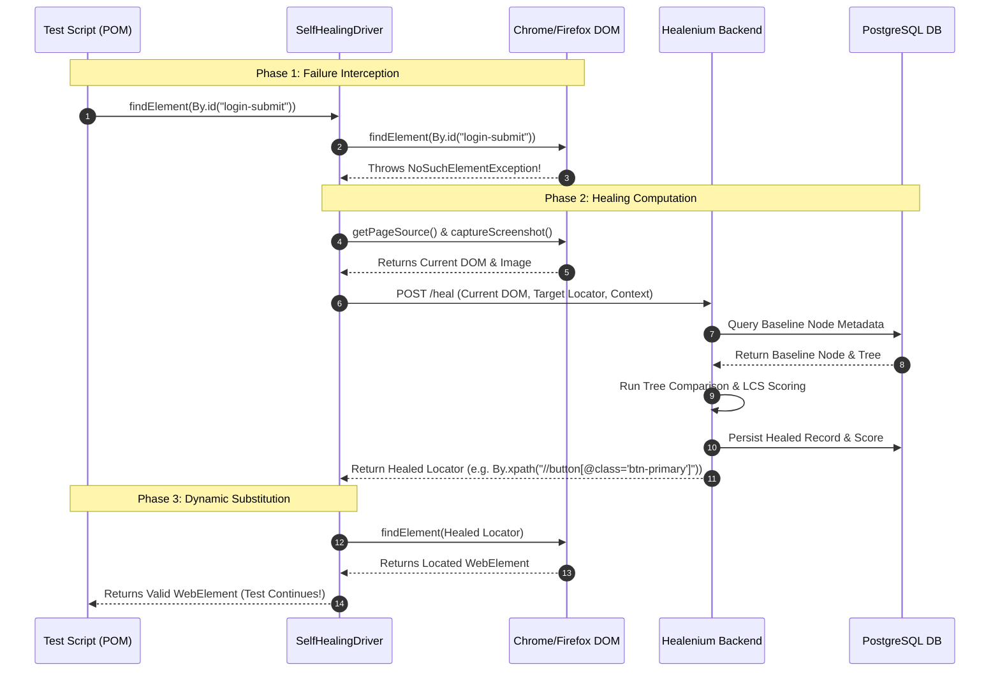

# Module 02: Healenium Architecture & Workflow Deep Dive

[⬅ Previous: Introduction](01_introduction_to_healenium.md) | [📚 Master Index](../README.md) | [Next: Core Technical Concepts ➡](03_core_technical_concepts.md)

---

## 2.1 Architectural Components Overview
The Healenium ecosystem comprises four main logical components:

```
+--------------------------------------------------------------------------------------+
|                                 HEALENIUM ARCHITECTURE                               |
|                                                                                      |
|   +-----------------------+              +---------------------------------------+   |
|   |   Automation Suite    |              |       Docker / Host Environment       |   |
|   |  (Java / TestNG /     |              |                                       |   |
|   |   Page Object Model)  |              |   +-------------------------------+   |   |
|   +-----------+-----------+              |   |     Healenium Backend         |   |   |
|               |                          |   |        (Port 7883)            |   |   |
|        [healenium-web]                   |   |  - Similarity Engine          |   |   |
|        (SelfHealingDriver)               |   |  - REST APIs                  |   |   |
|               |                          |   |  - Web Reporting Dashboard    |   |   |
|               |  1. Find Element         |   +---------------+---------------+   |   |
|               +------------------------->|                   |                   |   |   |
|               |                          |                   | SQL Queries       |   |   |
|               |  2. If Broken:           |                   v                   |   |   |
|               |     POST /heal/elements  |   +---------------+---------------+   |   |
|               +------------------------->|   |     PostgreSQL DB             |   |   |
|               |                          |   |        (Port 5432)            |   |   |
|               |  3. Return Candidate     |   |  - Baseline Trees             |   |   |
|               |<-------------------------+   |  - Selector History           |   |   |
|               |                          |   |  - Healing Results            |   |   |
|               v                          |   +-------------------------------+   |   |
|   +-----------+-----------+              +---------------------------------------+   |
|   |    Target Browser     |                                                          |   |
|   |  (Chrome/Edge/Firefox)|                                                          |   |
|   +-----------------------+                                                          |   |
+--------------------------------------------------------------------------------------+
```

### 1. Healenium Web (`healenium-web`)
* **Role:** A Java client library that acts as a wrapper around Selenium's native `WebDriver`.
* **Mechanism:** Implements a proxy/decorator pattern around `WebDriver` and `WebElement`. When `driver.findElement(By)` is invoked, it delegates first to the standard Selenium driver. If successful, it captures element context (DOM tree, node attributes, position) and asynchronously transmits it to the backend to update the baseline. If `NoSuchElementException` is encountered, it triggers the recovery routine.

### 2. Healenium Proxy (`healenium-proxy`)
* **Role:** A language-agnostic, middleware proxy server sitting between client test code and Selenium Grid / WebDriver.
* **Mechanism:** Conforms to the W3C WebDriver Specification. It intercepts standard HTTP wire commands (e.g., `POST /session/{id}/element`). If the browser node returns an error status code (Element Not Found), the proxy captures the page source directly from the browser session, calls the Healenium Backend for matching, and rewrites the command using the healed locator before returning the result to the test runner. This enables Python, C#, Robot Framework, and JavaScript suites to use Healenium without rewriting their codebase into Java.

### 3. Healenium Backend (`healenium-backend`)
* **Role:** The analytical brain of the ecosystem, packaged as a Spring Boot microservice.
* **Responsibilities:**
  * Computes similarity scores between historical baseline elements and candidate nodes in the current DOM.
  * Manages the lifecycle of selectors, healing sessions, and test execution metadata.
  * Hosts the embedded **Healenium Web Reporting Dashboard** (accessible via browser at `http://localhost:7883/healenium/report/`).
  * Exposes RESTful endpoints (e.g., `/healenium/selector`, `/healenium/elements`) consumed by client drivers or proxy layers.

### 4. PostgreSQL Database
* **Role:** Relational persistence engine.
* **Schema Content:**
  * `selector`: Stores original locator strings, locator types (`xpath`, `id`, `css`), command keys, and unique hashes.
  * `meta`: Stores contextual metadata including page URL, test class name, method name, and browser parameters.
  * `healing`: Stores healing events, historical baseline DOM trees, screenshot hashes, calculated similarity scores, healed selector values, and manual validation statuses (accepted/rejected/pending).

---

## 2.2 Step-by-Step Locator Healing Workflow

### Stage 1: The Baseline Capture (Passing Test Execution)
1. The test triggers `driver.findElement(By.id("login-submit"))`.
2. Selenium searches the browser DOM and successfully finds the element.
3. The Healenium client/proxy intercepts the successful response.
4. It extracts node metadata: HTML tag name, all attributes (`id`, `class`, `name`, `type`, custom attributes), text content, parent/child hierarchy, and surrounding DOM subtree.
5. This metadata is sent to `Healenium-Backend` and recorded in PostgreSQL as the **Baseline State** for `By.id("login-submit")`.
6. Control returns to the test script with zero disruption.

### Stage 2: The Failure Detection (DOM Has Changed)
1. A new build modifies the button markup: `<button id="login-submit">` becomes `<button id="btn-auth-submit" class="btn-primary">`.
2. The test triggers `driver.findElement(By.id("login-submit"))`.
3. The underlying Selenium WebDriver queries the DOM, fails to match `login-submit`, and raises a `NoSuchElementException`.
4. Traditional Selenium would abort execution immediately. Healenium catches this exception in its wrapper layer.

### Stage 3: The Healing Computation
1. Healenium captures the current, full page DOM tree and current viewport screenshot from the active browser session.
2. It constructs an HTTP request to `Healenium-Backend` containing:
   * Original locator identifier and type.
   * Current page DOM structure.
   * Current execution context (test method, class).
3. The backend retrieves the historical baseline DOM node and its contextual signature from PostgreSQL.
4. The algorithm traverses the current DOM, filtering candidate nodes with matching or compatible tag structures.
5. For each candidate node, it computes a multi-factor similarity score (weighing tag, path, attributes, text, and relative positioning).
6. Candidates exceeding the configured score threshold (e.g., `score-cap=0.6`) are sorted by similarity. The candidate with the highest score is chosen.

### Stage 4: Runtime Substitution & Reporting
1. The backend constructs a new, valid locator path (such as an optimized XPath or CSS selector) pointing precisely to the selected candidate.
2. The backend sends the healed selector and candidate details back to the client wrapper or proxy.
3. The client driver executes `findElement` using the healed locator. The target element is located and returned as a standard `WebElement`.
4. A healing event record is created in PostgreSQL with:
   * Original locator vs. Healed locator.
   * Matching similarity percentage.
   * Visual screenshots (highlighting the baseline vs. the healed element).
5. The test execution continues uninterrupted, executing clicks, typing, or assertions.



---

## 2.3 Integration Approaches: Healenium-Web vs. Healenium-Proxy

Understanding when to choose `healenium-web` versus `healenium-proxy` is a vital SDET architectural decision:

```
Approach A: Native Client Library (Healenium-Web)
[Java Test Suite] ---> [SelfHealingDriver Decorator] ---> [Selenium WebDriver] ---> [Browser]
                                |
                                +-------------------------> [Healenium Backend] ---> [Postgres]

Approach B: Network Proxy (Healenium-Proxy)
[Any Suite: Python/C#/JS] ---> [Healenium Proxy Server] ---> [Selenium Grid/Browser]
                                      |
                                      +--------------------> [Healenium Backend] ---> [Postgres]
```

### Detailed Structural Comparison:

| Decision Factor | Healenium-Web (Client Approach) | Healenium-Proxy (Proxy Approach) |
| :--- | :--- | :--- |
| **Language Dependency** | Strictly **Java** (JDK 8/11/17+) | **Language-Agnostic** (Python, C#, JS/TS, Ruby, Go) |
| **Code Modification** | Minor: Wrap driver with `SelfHealingDriver.create(delegate)` | Zero client code changes: Point RemoteWebDriver URL to proxy |
| **Transport Overhead** | Minimal: Direct method calls; HTTP only during healing | Moderate: Every WebDriver command passes through the proxy network hop |
| **Ideal Use Case** | Pure Java/TestNG/JUnit enterprise frameworks | Multi-language orgs, Selenium Grid, or Dockerized Selenoid setups |
| **Setup Complexity** | Include Maven/Gradle dependency + `healenium.properties` | Deploy additional Docker container for `healenium-proxy` |

---

[⬅ Previous: Introduction](01_introduction_to_healenium.md) | [📚 Master Index](../README.md) | [Next: Core Technical Concepts ➡](03_core_technical_concepts.md)
